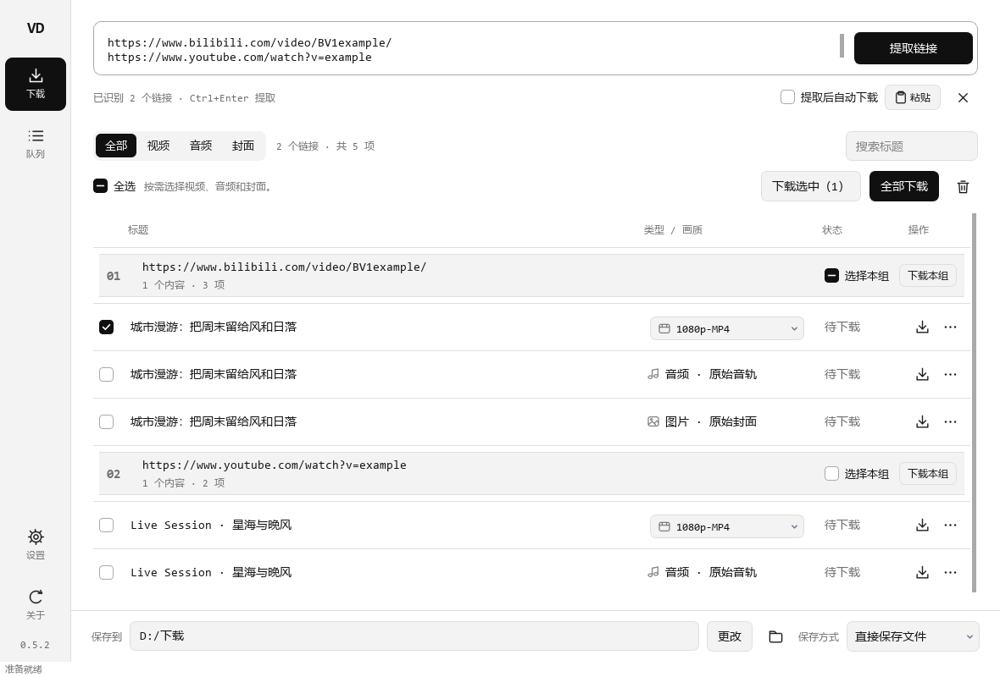

# VideoDL Desktop

Windows 桌面版，用于批量保存视频封面、独立音频和视频。界面基于 PySide6，下载内核来自 [CharlesPikachu/videodl](https://github.com/CharlesPikachu/videodl)。



## 下载与使用

1. 在 [GitHub Releases](https://github.com/Chihiro521/videodl/releases) 选择 `desktop-v` 开头的发行版，下载 `VideoDL-Desktop-版本-windows-x64.zip`。
2. 完整解压 ZIP，然后双击文件夹里的 `VideoDL Desktop.exe`。保留同目录下的 `_internal` 文件夹。
3. 在“下载”首页粘贴一行、多行链接或分享文本，软件会显示识别数量。相同地址按首次出现去重，单批最多 200 条。点击“提取链接”或按 `Ctrl+Enter` 开始，输入区会收紧到顶部，每条来源链接独立成组，按输入顺序显示。
4. 每组中的视频、音频和封面分别列成独立行，多视频或分P也留在原组内。视频的“类型 / 画质”列可直接选择 `1080p-MP4` 等实际可用版本，默认选择最高档。组头提供“选择本组”和“下载本组”；顶部可跨组勾选下载或“全部下载”。这些操作都处理当前搜索和类型筛选范围，并遵循每行的画质选择。
5. 窗口底部可选择保存位置及“保存方式”：**直接保存文件**不建作品文件夹；**按作品分文件夹**把同一作品的视频、音频和封面放在一起；**按类型分文件夹**分别放进“视频”“音频”“封面”。同名文件或不同作品的同名文件夹自动增加编号。完成后点击文件夹按钮可打开文件所在位置。
6. “下载队列”保留详细进度、暂停、取消、重试和历史记录。首页也可开启“提取后自动下载”，自动下载的内容在“设置”中选择。

发行包内提供 Python 运行环境、FFmpeg、ffprobe 和 Node.js 运行时，适用于 Windows 10/11 x64。部分上游解析器还依赖浏览器或其他外部工具，其可用范围以具体解析结果为准。

## 音频、画质与队列

- 界面参考 cobalt 的黑白、等宽字体和紧凑控件，空闲时居中输入，提取后展开结果。设置中的外观可选择跟随系统、浅色或深色；恢复了历史结果时直接显示列表。
- 结果按稳定条目复用控件，刷新进度时保留滚动位置、焦点、勾选和画质；搜索约 150ms 后更新。滚轮经过画质框会滚动列表，展开下拉框后才能用滚轮切换选项。
- 每条来源链接有固定的分组位置，后面的链接先提取完成也不会插队。组头显示序号、完整来源提示和内容数量；等待、提取中及失败状态留在对应组内。失败组可单独重试，其他组继续处理。

- 每个分辨率只展示一个推荐版本，其他版本位于行末“更多 → 其他编码 / 格式”。优先保留较高帧率，同帧率优先兼容性较好的 MP4/H.264；不会删除来源提供的其他版本。
- 开始新一批提取时替换旧结果并清除未在运行的队列，正在下载的任务继续；已下载的文件保留。编辑输入框不会清空，重试失败链接也会保留同批成功结果。
- B站可在“设置 → B站高清画质”用哔哩哔哩 App 扫码登录一次。之后提取自动使用账号可访问的画质；登录失效时重新扫码。登录状态通过 Windows 当前用户加密保存，可在设置中清除。登录或清除后重新提取即可更新画质列表。

- 音频优先使用解析器提供的独立音轨；没有独立音轨时先取得媒体，再使用 `-c:a copy` 提取，保留原始编码。AAC 一般保存为 `.m4a`，其他编码使用匹配的容器。
- 所有平台共用画质列表和下载流程。桌面适配层整理上游格式列表、HLS/DASH 多档资源及可用的独立音视频流；只有一档时显示单档，分辨率未知时显示“来源画质”。实际画质范围取决于来源当次返回的资源。
- 提取结果优先使用真实标题；临时占位标题会从原始元数据或网页信息补齐，信息仍缺失时使用稳定的来源编号。
- 提取与下载复用后台进程和内存中的解析对象，缓存有效期为 10 分钟，全局最多保留 48 个链接（低于 50 条上限）。缓存失效会自动重新提取，媒体地址提前失效时自动刷新一次。
- 已知平台优先使用对应解析器，后备通道采用固定顺序并优先最近成功通道。单链接提取上限 60 秒，可随时停止。
- 提取默认同时处理 2 个链接，可在设置中调整为 1–3 个。失败链接既可在各自组头重试，也可集中重试或查看详情；停止提取会保留已取得的结果，未完成组可单独重试。
- 同一条目的视频、音频、封面可一起选择，合并到同一下载任务，避免重复下载媒体。某项失败时，已成功的行仍显示完成。
- 多分P会逐个列出，下载时按稳定媒体编号重新匹配。条目编号与临时标题、时间戳分开；指定版本已经不可用时，会提示重新选择画质。
- 默认同时处理 1 个下载任务，可调整为 1–3 个。“暂停队列”暂停启动后续任务，正在处理的任务继续运行。
- 取消会停止任务的后台进程及媒体工具。重新启动程序后，可点击“重试未完成”重新解析和下载。重试从头下载，同名文件自动增加编号。
- 批量下载音频：切换上方“音频”，选择保存方式，再点“批量下载音频”；视频和封面同理。“直接保存文件”将成品平铺在保存位置，“按作品分文件夹”按标题分组，“按类型分文件夹”将同类成品集中保存。只创建本次需要的分类。
- 保存方式会记住上次选择，每个新任务在加入队列时固定自己的保存方式；修改选项不改变已排队任务，重试继续使用原方式和作品目录。旧版设置与任务默认直接保存。
- 解析器工作目录及媒体中间文件放在程序内部临时目录，指定位置只出现成品及所选分类目录。跨磁盘发布先在保存位置之外完成复制，再放入成品；取消时清理本次临时目录及空的作品／分类目录。旧文件和已有目录保留。
- “清空提取结果”和“从列表移除此项”只移除结果记录，下载任务和文件保留。“清理记录”只清理已经结束的任务记录。

## 本地记录

设置、结果列表和队列保存在 `%LOCALAPPDATA%\VideoDL Desktop`，包含用户输入的来源链接、内容标题、文件路径、来源顺序和任务状态。解析器返回的临时下载地址与原始响应均不写入这些记录。旧版设置和下载记录可以继续使用；旧结果按链接首次出现的顺序恢复分组。

## 更新

“关于与更新”检查 `Chihiro521/videodl` 中以 `desktop-v` 开头的正式发行版，并展示原作者的最新提交。下载新版、解压到新目录后运行，设置和历史记录会继续使用同一份本地数据。

上游源码更新通过同步 PR、兼容测试和适配后，再发布桌面版。桌面程序检查发行版，不直接修改正在运行的源码。

## 从源码运行

```powershell
git clone --branch desktop https://github.com/Chihiro521/videodl.git
cd videodl
uv venv --python 3.12
uv pip install --python .venv/Scripts/python.exe -r desktop/requirements.txt
```

安装依赖后双击仓库根目录的 `启动桌面版.vbs`。开发时也可运行：

```powershell
.\.venv\Scripts\python.exe -m desktop
```

源码运行的媒体处理依赖系统里的 FFmpeg 和 ffprobe，发行包中则提供对应工具。

## 构建、测试与发布

上游定时同步、扫描、草稿 PR 和一键生成发行草稿的操作见 [自动化维护](AUTOMATION.md)。

```powershell
uv pip install --python .venv/Scripts/python.exe -r desktop/requirements.txt pyinstaller==6.22.3 pytest==9.1.1
.\.venv\Scripts\python.exe -m pytest desktop/tests -q
.\.venv\Scripts\python.exe -m desktop.build
```

输出位于 `dist/desktop/`，包含便携文件夹、ZIP 和 `SHA256SUMS.txt`。构建需要 Git、网络和全新输出目录。FFmpeg 使用 `media-tools.json` 中固定的下载地址与 SHA-256；Python 依赖固定在 `requirements.txt`。

构建只收录所需的源码和资源，生成独立的发行用上游副本，清除源码内置的 Cookie、服务 token 和密钥默认值；相关解析器的可用性仍需单独验证。构建不会修改工作区的上游源码。发行包不包含 `.wvd` 身份文件、本机配置、日志和历史下载。`public-build-audit.json` 记录处理的字段名，`build-info.json` 记录构建版本，`THIRD-PARTY-NOTICES.txt` 保留依赖说明与来源。

推送 `desktop-v0.3.0` 等版本标签会触发 Windows 测试和打包，并创建 GitHub 草稿发行版。验证草稿附件后发布。具体分支操作见 [MAINTAINING.md](MAINTAINING.md)。

## 验证范围

自动测试使用本地 HTTP 服务提供的真实小型媒体，覆盖批量提取、类型筛选、勾选下载、自动下载偏好、结果恢复、条目重新匹配、三种输出、原始音频数据一致性、同名文件、部分失败、队列恢复和取消。打包版本在精简 PATH 下验证窗口启动、后台下载以及“提取→选择→下载”的完整 GUI 流程。

平台解析能力继承自上游；各平台网站变化、登录状态和外部接口可用性都会影响结果。具体平台实测结果记录在每个发行版说明中。

本机性能与验证记录见 [v0.3.0 验证记录](VALIDATION_0.3.0.md)。可用 `python -m desktop.benchmark --old 旧版exe --new 新版exe --media 小型MP4 --output 全新记录目录` 重复比较两个便携版本，默认交替运行三轮。
